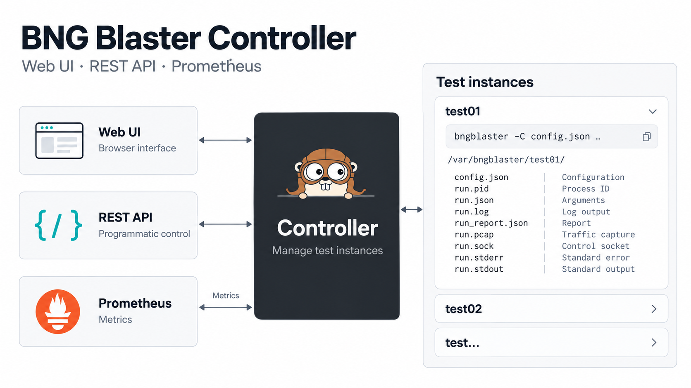

# BNG Blaster Control Daemon

[](https://github.com/rtbrick/bngblaster-controller/actions/workflows/build.yml)
[](https://github.com/rtbrick/bngblaster-controller/blob/main/LICENSE)
[](https://rtbrick.github.io/bngblaster/controller.html)
[](https://rtbrick.github.io/bngblaster-controller)

The [BNG Blaster](https://github.com/rtbrick/bngblaster) controller provides
a REST API to start and stop multiple test instances. It exposes the
BNG Blaster [JSON RPC API](https://rtbrick.github.io/bngblaster/api/index.html)
as REST API and provides endpoints to download logs and reports. 



## Installation

This version of the BNG Blaster controller requires
[BNG Blaster](https://github.com/rtbrick/bngblaster) 1.0.0 or newer.

Pre-built debian packages, as well as plain `tar.gz` archives, are
published on the [GitHub releases page](https://github.com/rtbrick/bngblaster-controller/releases).

Installing the Debian package registers and starts a systemd service:

```
$ sudo dpkg -i bngblaster-controller_<version>_amd64.deb
```

This installs the `bngblasterctrl` binary to `/usr/local/bin/bngblasterctrl`,
a systemd unit (`rtbrick-bngblasterctrl.service`), a default environment
file at `/etc/default/rtbrick-bngblasterctrl` (see
[Configuration](#configuration) below), and a logrotate policy at
`/etc/logrotate.d/rtbrick-bngblasterctrl` for the service's stdout/stderr log
files under `/var/log/`. The service is enabled and started automatically.

Alternatively, build from source:

```
$ make build
$ sudo ./bin/<os>_<arch>/bngblasterctrl
```

The blaster instance needs at least the permissions required to run
the `bngblaster` itself.

## Usage

The controller comes with good defaults, just starting the controller will give you an instance that:

* runs on port `8001`
* assumes bngblaster is installed at `/usr/bin/bngblaster`
* uses `/var/bngblaster` as storage directory 

```
$ /usr/local/bin/bngblasterctrl -h
Usage of /usr/local/bin/bngblasterctrl:
  -addr string
    	HTTP network address (default ":8001")
  -allowed-hosts string
    	comma-separated host names clients may use to reach the controller, against DNS rebinding (IP addresses and localhost are always allowed; empty allows any host)
  -bgpupdate string
    	bgpupdate executable (default "/usr/bin/bgpupdate")
  -color
    	turn on color of color output
  -console
    	turn on pretty console logging (default true)
  -d string
    	config folder (default "/var/bngblaster")
  -debug
    	turn on debug logging
  -e string
    	bngblaster executable (default "/usr/bin/bngblaster")
  -generators
    	enable the lspgen, bgpupdate and ldpupdate generator endpoints (disable with -generators=false) (default true)
  -host-api
    	enable the host information endpoints (disable with -host-api=false) (default true)
  -interfaces-api
    	enable the interfaces endpoint (disable with -interfaces-api=false) (default true)
  -ldpupdate string
    	ldpupdate executable (default "/usr/bin/ldpupdate")
  -log-ui
    	also log successful read requests of the web UI (its polling) at info level; failed requests and actions are always logged
  -lspgen string
    	lspgen executable (default "/usr/bin/lspgen")
  -schema string
    	path to the bngblaster configuration JSON schema served on /api/v1/schema (default "/usr/share/bngblaster/bngblaster-config.json")
  -ui
    	enable the embedded web UI (experimental, disable with -ui=false) (default true)
  -upload
    	enable file upload (disable with -upload=false) (default true)
```

## Logging

Every request is logged as one line once it has been handled, with its
method, path, HTTP status and duration, followed by the instance, the action
it performed (`started`, `deleted`, `uploaded`, ...) and, for a failed
request, the error returned to the client:

```
2026-10-28 10:15:02 UTC INF POST /api/v1/instances/x/_start 204 1.24s action=started instance=x remote_addr=10.0.0.5
2026-10-28 10:15:09 UTC WRN POST /api/v1/instances/x/_start 412 3ms error="instance is running" instance=x remote_addr=10.0.0.5
```

Successful requests are logged at info level, client errors (4xx) as
warnings and server errors (5xx) as errors. Warnings and errors go to stderr,
everything else to stdout, so with the systemd service
`/var/log/rtbrick-bngblasterctrl-service-err.log` lists every failed request.

The web UI polls the controller every few seconds and marks its requests
with the `X-Bngblaster-Client: webui` header (logged as `client=webui`).
By default those successful reads are logged at debug level only, so the
polling does not flood the log; `-log-ui` logs them at info level like any
other request. Failed requests and actions such as start, stop, delete,
upload and non-read-only commands are always logged. `-debug` shows everything,
including the source location of each line. `-console=false` switches to
JSON lines.

## Configuration

### Command line

All options above can be passed directly on the command line when running
`bngblasterctrl` manually.

### systemd service

When installed via the debian package, the service is started by
systemd and does not take command-line arguments directly. Instead, flags are
configured through `/etc/default/rtbrick-bngblasterctrl`, which is sourced by
the unit as an `EnvironmentFile` and expanded into `ExecStart` via the
`BNGBLASTERCTRL_OPTS` variable:

```
# /etc/default/rtbrick-bngblasterctrl
BNGBLASTERCTRL_OPTS="-addr :8080 -d /var/bngblaster"
```

After editing the file, apply the change with:

```
$ sudo systemctl restart rtbrick-bngblasterctrl
```

This file is preserved across package upgrades and is the recommended way to
configure the service; editing the unit file directly (e.g. via
`systemctl edit rtbrick-bngblasterctrl`) also works but is not required.

A fresh install enables and starts the service. Upgrades keep whether the
service is enabled and only restart it if it was running.

The unit applies a conservative systemd sandbox: `/usr`, `/boot`, `/efi` and
`/etc` are read-only, `/home` and `/root` are read-only, `/tmp` is private to
the service, and kernel modules, kernel logs, cgroups, the clock and the
hostname cannot be changed. Home directories remain readable, so
configurations may reference stream, BGP or MRT files kept there. The config
folder (`-d`) must live outside the read-only paths and `/tmp` (the default
`/var/bngblaster` is fine). If a setup needs more, relax individual settings
with `systemctl edit rtbrick-bngblasterctrl`.

Note that the `bngblaster` instances run inside the service's control group,
so stopping or restarting the service (including through a package upgrade)
also stops every running test instance.

## Experimental Web UI

The controller ships with an embedded, experimental web UI for creating and
observing test instances without calling the REST API directly. It is
**enabled by default**, along with the additional endpoints it depends
on:

* `-ui` — serves the web UI on `/`
* `-interfaces-api` — serves `/api/v1/interfaces`, used by the web UI to
  populate the host network interface dropdown when creating a new instance
* `-host-api` — serves `/api/v1/host`, `/api/v1/host/interfaces` and
  `/api/v1/host/topology.png`, used by the web UI's host view (CPU, NUMA,
  memory and disk usage, the CPUs pinned by bngblaster instances, and the
  network interfaces with driver, PCIe link and queues); interface details
  are more complete with `ethtool` installed, and the topology image
  requires `lstopo` from the `hwloc` package
* `-upload` — enables the `/api/v1/instances/{instance_name}/_upload`
  endpoint, used by the web UI (and the REST API) to upload files into a
  test instance
* `-generators` — serves `/api/v1/generators` and
  `/api/v1/instances/{instance_name}/_generate/{tool}`, used by the web UI's
  Generate tab to run the BNG Blaster file generators `lspgen`, `bgpupdate`
  and `ldpupdate` in an instance folder (see below); the executables are set
  with `-lspgen`, `-bgpupdate` and `-ldpupdate`

Each of them can be disabled individually by setting the flag to `false`,
e.g. to run a REST-only controller:

```
$ /usr/local/bin/bngblasterctrl -ui=false -interfaces-api=false -host-api=false -upload=false -generators=false
```

or, for the systemd-installed service, in `/etc/default/rtbrick-bngblasterctrl`:

```
BNGBLASTERCTRL_OPTS="-ui=false -interfaces-api=false -host-api=false -upload=false -generators=false"
```

## File Generators

The BNG Blaster ships generators for the files its routing protocols load:
`lspgen` (ISIS/OSPF topologies as MRT, PCAP, stream and graphviz files),
`bgpupdate` and `ldpupdate` (BGP and LDP RAW update files). The controller
runs them in the instance folder, so the generated files can be referenced
by the instance configuration (e.g. an `external` `mrt-file` or a
`raw-update-file`) or, while the instance is running, loaded via `_command`
(`bgp-raw-update`, `ldp-raw-update`, `isis-load-mrt`, `ospf-load-mrt`):

```
$ curl -X POST http://localhost:8001/api/v1/instances/test/_generate/bgpupdate \
    -d '{"next-hop-base": "10.0.0.1", "prefix-base": "11.0.0.0/24", "prefix-num": 1000, "file": "start.bgp"}'
```

The request takes the tool's long option names; `GET /api/v1/generators`
lists them per tool and whether the tool is installed (`bgpupdate` and
`ldpupdate` also need Python 3 with scapy). Files are written under a
temporary name and only moved into place once the tool succeeded, so a failed
run leaves nothing behind. While an instance is running, existing files are
never replaced: bngblaster loads a RAW update file once per file name, so
each further update needs a new name. lspgen's control socket mode is not
supported.

Note that the web UI needs the interfaces, host and upload endpoints for some of
its features, so disabling them while keeping `-ui` enabled leaves those
parts of the UI non-functional.

With the defaults, open `http://<host>:<port>/` in a browser. As the UI is experimental,
expect rough edges, and only expose the controller on networks you trust, since none of
these endpoints require authentication yet.

## Security

The REST API and web UI do not require authentication yet, so restrict who
can reach the port (bind `-addr` to a management address, firewall it, or
tunnel through SSH). On top of that, the controller:

* rejects state-changing requests (`PUT`, `POST`, `DELETE`) that a browser
  sends on behalf of another site (checked via the `Sec-Fetch-Site` and
  `Origin` headers), so a malicious web page cannot drive the controller
  through the browser of someone on the lab network. Clients such as curl or
  scripts send neither header and are not affected;
* with `-allowed-hosts`, rejects requests addressed to any other host name,
  which prevents DNS rebinding attacks from reading API responses. IP
  addresses and `localhost` are always accepted. Set it to the names used to
  reach the controller, e.g. `-allowed-hosts lab01,lab01.example.com`;
* sends `X-Frame-Options`, a restrictive `Content-Security-Policy` and
  related headers on every response;
* confines file uploads and downloads to the instance folder, and rejects a
  relative `stream_config` (`_start`) that escapes it (e.g. `../x`). An
  absolute `stream_config` is passed to bngblaster as-is, so files kept
  elsewhere on the host (e.g. in a home directory) can be used;
* limits request sizes (32 MB per configuration, 4000 MB per upload) and
  rejects uploads larger than the free disk space;
* logs the client address of every request and of each lifecycle change.

## License

BNG Blaster is licensed under the BSD 3-Clause License, which means that you are free to get and use it for
commercial and non-commercial purposes as long as you fulfill its conditions.

See the LICENSE file for more details.

## Copyright

Copyright (C) 2020-2026, RtBrick, Inc.

## Contact

bngblaster@rtbrick.com